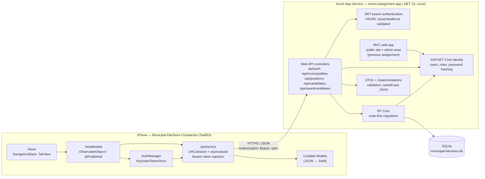

# System Architecture

COMP4977 Municipal Elections — the iOS client consumes a JWT-secured ASP.NET
Core Web API deployed to Azure App Service, which stores election data in
SQLite through EF Core.

## Request flow (authenticated call)

1. The user signs in on the **Login** screen; `AuthViewModel` validates the
   input and `ApiService` posts to `POST /api/auth/login`.
2. The API verifies the password with ASP.NET Core Identity and returns a
   signed JWT (`AuthResponse.token`).
3. `AuthManager` stores the token in the Keychain (`KeychainTokenStore`) and
   pushes it into `ApiService`, which attaches
   `Authorization: Bearer <token>` to protected requests.
4. Protected endpoints (`/api/savedcandidates`) validate the token with the
   JWT bearer handler and resolve the user id from the `nameidentifier` claim.
5. EF Core reads/writes SQLite; results are projected into camelCase DTOs
   (`SavedCandidateDto` embeds the full `CandidateDto`).

## Layers

| Layer | iOS | API |
| ---- | --- | --- |
| Presentation | SwiftUI views (`Views/`) | MVC views (previous assignment) |
| State | ViewModels `ObservableObject` (`ViewModels/`) | — |
| Networking / contracts | `ApiService`, Codable models | Controllers (`Controllers/Api/`), DTOs (`DTOs/Api/`) |
| Auth | `AuthManager`, Keychain token store | ASP.NET Core Identity + JWT bearer |
| Persistence | — | EF Core code-first → SQLite |

## Notes

- The MVC app and the mobile API share one ASP.NET Core project and one
  database. The MVC app keeps cookie authentication as the default scheme;
  API controllers opt into the JWT scheme explicitly, so the two coexist.
- The API is stateless: the JWT carries the user identity and the database
  holds the voting guide (`SavedCandidate`).
- Configuration: the iOS app reads its base URL from a bundled `.env`
  (`API_BASE_URL`) shipped via `xtool.yml` `resources`.
