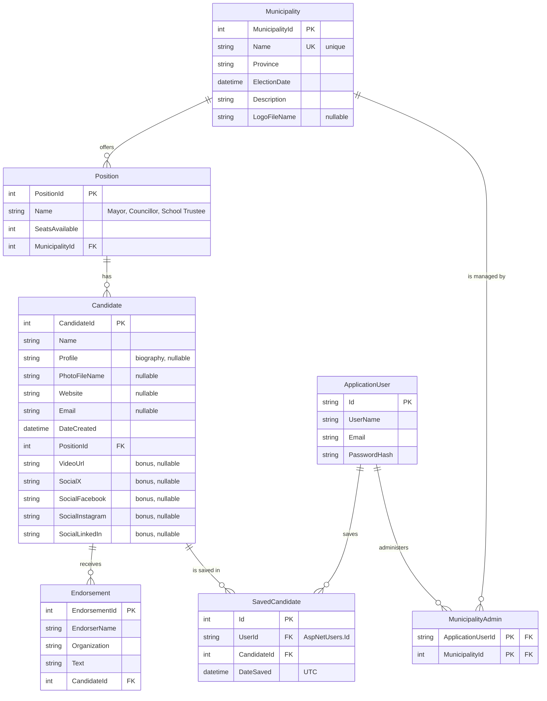

# Entity Relationship Diagram

Municipal Elections — EF Core Code First model used by both the MVC
administration app and the mobile REST API.

## Notes

- `ApplicationUser` extends ASP.NET Core Identity's `IdentityUser`; Identity's
  own `AspNetRoles`, `AspNetUserRoles`, and related tables are generated by the
  framework.
- `SavedCandidate` is the mobile app's voting guide: one row per user per saved
  candidate, with a **unique index on `(UserId, CandidateId)`** so a candidate
  cannot be saved twice by the same user. Deleting the user or the candidate
  cascades. The API exposes it at `/api/savedcandidates`. (The previous MVC app
  still uses its own session-based voting guide and does not read this table.)
- `MunicipalityAdmin` is the join table that scopes a municipality admin user
  to a single municipality. It has a composite primary key of
  `ApplicationUserId` + `MunicipalityId`.
- `Position`, `Candidate`, `Endorsement`, `MunicipalityAdmin` and
  `SavedCandidate` cascade on delete, so deleting a municipality removes its
  positions, candidates, endorsements, admin mappings, and saved-guide rows.
- `Municipality.Name` carries a unique index, so no two municipalities may
  share a name.
